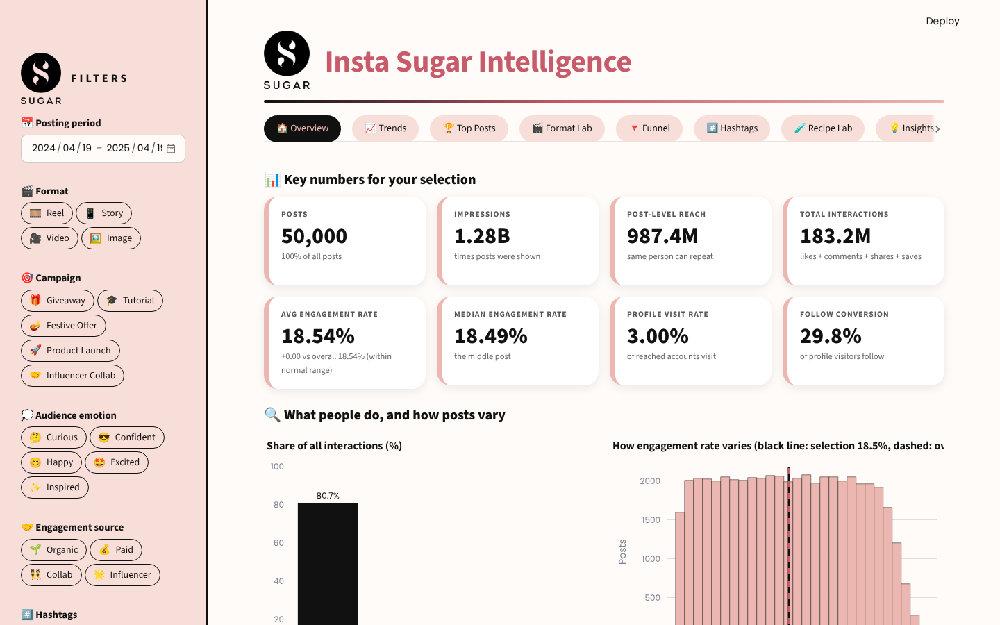

# Insta Sugar Intelligence — Instagram Analytics for Sugar Cosmetics

**Live app:** https://insta-sugar-intelligence.streamlit.app/

An interactive Streamlit dashboard that analyses 50,000 Instagram post records for Sugar Cosmetics. It tests which formats, campaigns, posting days and hashtags really get more engagement, and which only look better by luck.

Project 6 of 8 · Built during my Data Analyst Internship at Labmentix (Aug–Nov 2026).




## The business question

Sugar Cosmetics' marketing team posts a lot of content. They want to know what works: Reels or images? Giveaways or tutorials? Which day? Which hashtags?

**Goal:** show which content choices are linked to higher engagement, and which differences are too small to act on.

## Key results

| KPI | Value |
|---|---|
| Post records | **50,000** (19 Apr 2024 – 19 Apr 2025) |
| Impressions | **1.28 billion** |
| Total interactions | **183.2 million** |
| Average engagement rate | **18.54%** |
| Profile visit rate | **3.0%** of reached accounts |
| Follow conversion | **29.8%** of profile visitors |

**Engagement rate** = (Likes + Comments + Shares + Saves) ÷ Reach × 100

## Key findings

The main finding: **no single format, campaign, day or hashtag clearly wins.** Every gap is smaller than the margin of error. A **p-value** is the chance of seeing a gap this big by luck alone, and it needs to be under 0.05 to count as real:

| Question | Best vs worst | p-value | Verdict |
|---|---|---|---|
| Which format? | Reel 18.61% vs Image 18.43% | 0.152 | Could be luck |
| Which day? | Wednesday 18.63% vs Sunday 18.42% | 0.566 | Could be luck |
| Which campaign? | Influencer Collab 18.60% vs Festive Offer 18.44% | 0.478 | Could be luck |
| Which emotion? | Curious 18.62% vs Excited 18.47% | 0.562 | Could be luck |
| Which source? | Collab 18.59% vs Organic 18.44% | 0.349 | Could be luck |
| How many hashtags? | 2 tags 18.63% vs 1 tag 18.44% | 0.054 | Just misses |

Other findings:
- **Likes are 80.7% of all interactions.** Comments are 10.1%, saves 4.8% and shares 4.4%.
- **Likes measure audience size, not quality.** Likes and reach are strongly linked (r = 0.79), but reach and engagement rate are not (r = 0.00). None of the 10 most-liked posts is in the top 10 by engagement rate.
- **The biggest drop-off** is from interactions to profile visits: only about 16% continue. In the end, about 0.7% of impressions turn into a follow.
- **Paid posts didn't reach more people** than organic posts (about 19,600 vs 19,970 on average).

## Recommendations

1. **Judge content by engagement rate, not likes.** Likes mostly reflect how many people saw a post.
2. **Use 18.5% as the baseline.** A new idea only counts as better if it clearly beats it.
3. **Don't make "best day" or "best format" rules.** The data doesn't support them. Spend the effort on the content itself.
4. **Track saves and shares separately.** They show stronger interest than likes.
5. **Fix the profile step.** Many people engage, but few visit the profile. Use clear profile links and calls to action.
6. **Run proper A/B tests** before deciding on any content "recipe".

## How it works

1. **Prepare the data in Google Colab** ([notebook](notebooks/Insta_Sugar_Intelligence_Data_Prep.ipynb)):
   - The raw file (50,000 rows, 14 columns) had no missing values or duplicates.
   - Kept high-performing outliers, because they are real posts.
   - Added 11 calculated fields (engagement rate, profile visit rate, follow conversion, weekday, month, hashtag count, post ID and more). The result is 50,000 rows × 25 columns.
2. **Test every comparison** with error bars and ANOVA (a test that checks whether group averages really differ), instead of just ranking the averages.
3. **Build the Streamlit app** with sidebar filters (date range, format, campaign, emotion, source, hashtags) and eight tabs:

| Tab | What it shows |
|---|---|
| 🏠 Overview | KPI cards, interaction mix, engagement rate spread |
| 📈 Trends | Posts and engagement over time (with partial months marked) |
| 🏆 Top Posts | Most-liked posts vs highest engagement rate posts |
| 🎬 Format Lab | Reel vs Story vs Video vs Image, with error bars |
| 🔻 Funnel | Impressions → reach → interactions → profile visits → follows |
| #️⃣ Hashtags | Each hashtag and the number of hashtags used |
| 🧪 Recipe Lab | **Unique feature:** tests 400 content "recipes" |
| 💡 Insights | What to do and what to avoid, for the marketing team |

### 🧪 The Recipe Lab

A **recipe** is a combination of format × campaign × emotion × source, which gives 400 recipes. Each one is compared with the 18.54% average. It only gets a **DO** or **DON'T** verdict if it passes a strict bar. The bar is raised because checking 400 recipes makes some look special by luck. Otherwise it gets **TEST**, which means "we can't tell yet".

Result: **no recipe passed.** The best one (Story + Product Launch + Confident + Organic) reached 20.96%. But a shuffle test showed random data produces about 20 "leaning" recipes anyway, and the real data has 24. So these are hints to test, not proven winners.

## Limitations

- **The data looks synthetic.** Every category is almost perfectly balanced, and engagement rates are spread very evenly.
- **No captions, post IDs or posting times.** So we can describe patterns but not explain why a post worked.
- **No budget data.** So we can't judge whether paid posts were worth their cost.
- **Engagement rate is defined by this project.** Other tools may calculate it differently.
- **Correlation, not cause.**

## Run it locally

```bash
git clone https://github.com/Vipsa2207/Insta-Sugar-Intelligence.git
cd Insta-Sugar-Intelligence
pip install -r requirements.txt
streamlit run app.py
```

## Project files

| File | What it is |
|---|---|
| `app.py` | The Streamlit app |
| `notebooks/Insta_Sugar_Intelligence_Data_Prep.ipynb` | Data preparation and analysis in Google Colab, with an insight after every visual |
| `data/sugar_cosmetics_instagram_data.xlsx` | Raw dataset (50,000 rows) |
| `data/sugar_instagram_clean.csv` | Cleaned dataset the app loads (50,000 rows × 25 columns) |
| `assets/` | Sugar logos and favicon |
| `requirements.txt` | Python libraries |

## Data source

Dataset provided by the Labmentix mentor for the internship. This project is not affiliated with Sugar Cosmetics.

## How I built it

I used AI to help write the Python code. I framed the business questions, chose the app design, checked every figure against the data, and wrote the findings.

## Author

**Vipsa Patel** — Data Analyst Intern, Labmentix · [LinkedIn](https://www.linkedin.com/in/vipsapatel)
